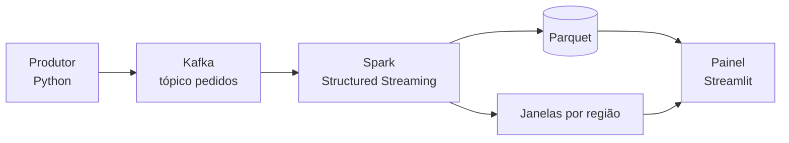

# Streaming de dados com Kafka e Spark

Demo local que mostra, passo a passo, como pedidos fictícios saem de um produtor, passam pelo Kafka, são processados pelo Spark Structured Streaming e viram métricas em um painel.

Um comando sobe todo o ambiente. A produção e o consumo ficam parados até você acionar no painel, para o público acompanhar cada etapa.

## Arquitetura



## Requisitos

- Docker e Docker Compose
- 8 GB de memória livres para o Docker
- Make
- Internet na primeira execução, para baixar as imagens

## Como executar

```bash
make demo
```

Depois, abra http://localhost:8501 e siga o [roteiro](docs/roteiro.md).

| Comando | O que faz |
|---|---|
| `make demo` | Sobe tudo e espera o painel ficar pronto |
| `make status` | Mostra os containers |
| `make parar` | Para os containers, mantendo os dados |
| `make reset` | Apaga os dados e volta ao estado inicial |

| Serviço | Endereço |
|---|---|
| Painel da demo | http://localhost:8501 |
| Streaming no Spark (com o consumo ativo) | http://localhost:4040/StreamingQuery/ |
| Spark Master | http://localhost:9091 |
| History Server | http://localhost:18081 |

Os containers voltam sozinhos quando o Docker reinicia. Os dados da demo ficam em `.demo/`, fora do git. Para remover os containers:

```bash
docker compose down
```

## Apresentação

- Roteiro: [docs/roteiro.md](docs/roteiro.md)
- Slides: [docs/streaming-kafka-spark.pptx](docs/streaming-kafka-spark.pptx)

Para gerar os slides de novo:

```bash
python3 -m venv .venv
.venv/bin/pip install python-pptx==1.0.2
.venv/bin/python docs/gerar_apresentacao.py
```

## Estrutura

```
apps/            produtor e painel
conf/            configuração do Spark
docker/          imagem do cluster
docs/            roteiro e slides
jobs/streaming/  consumidor com Structured Streaming
```

O ambiente usa 2 workers. Para mudar: `docker compose up -d --scale spark-worker=3`.

## Segurança

Esta demo é apenas para uso local. O Kafka e o Spark rodam sem autenticação, então não os exponha na rede.
